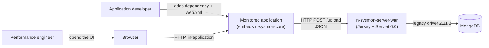
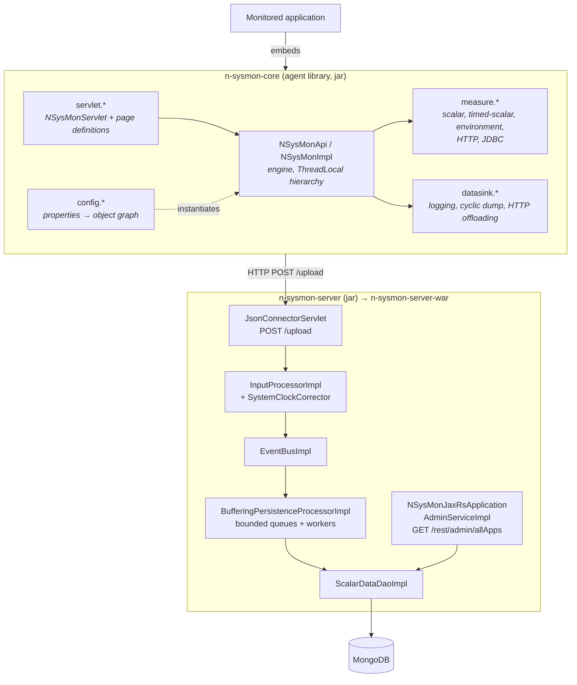
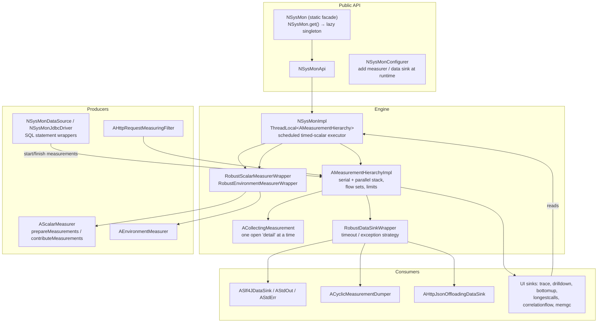
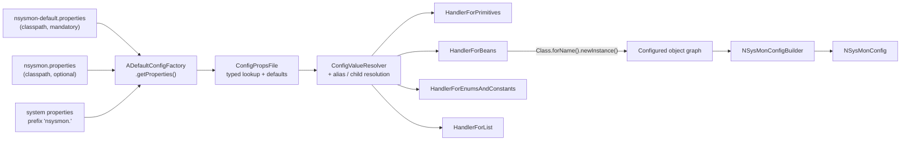
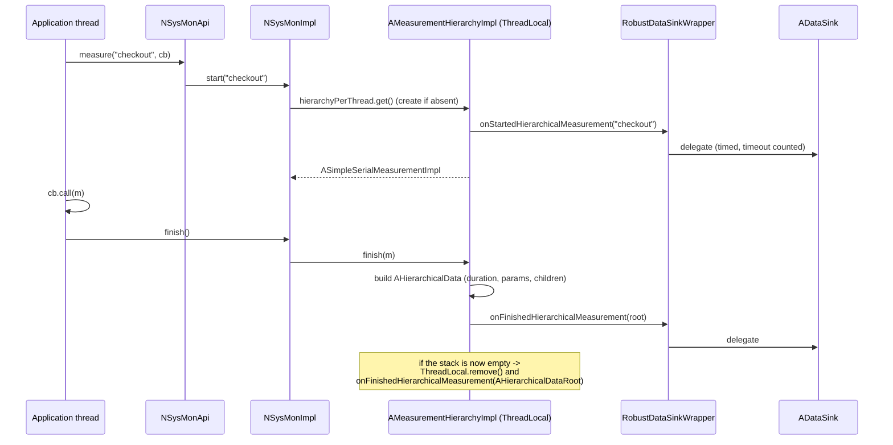
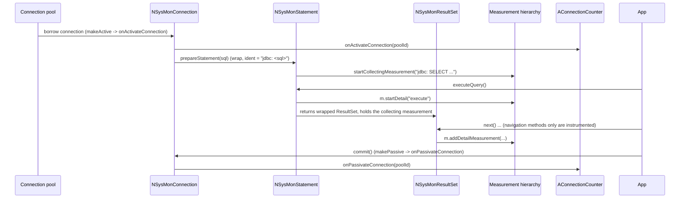
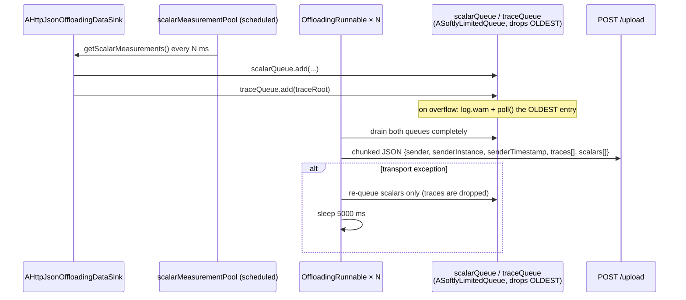
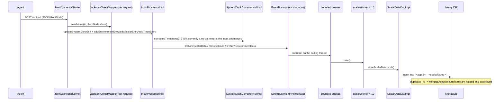
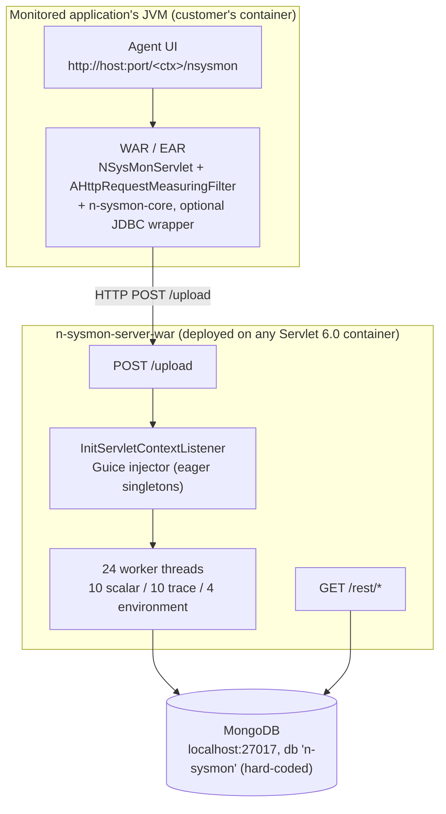
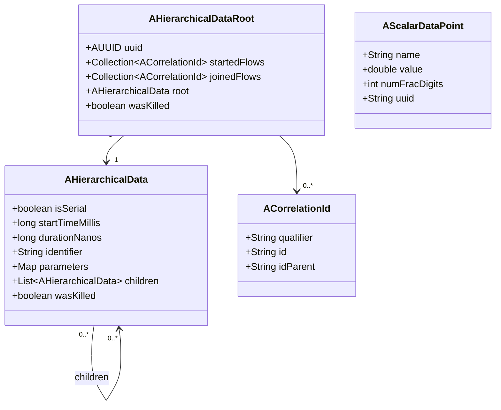

# Architecture Documentation (arc42)

**Project:** N-SysMon
**Version:** 1.5.2-SNAPSHOT
**Date:** 2026-10-03
**Status:** Draft

This document follows the [arc42 template](https://arc42.org/). It is grounded in the
source at commit `dd0ffb1` — every class, endpoint, configuration key and version
below was read from the code, not assumed.

---

## 1. Introduction and Goals

### 1.1 Requirements Overview

N-SysMon is a monitoring and exploration toolset for Java enterprise applications. It
is a fork of A-SysMon and consists of two cooperating halves:

- **An agent library** (`n-sysmon-core`) that a monitored application embeds. It
  instruments the application so it knows how much time is spent where, and exposes
  that as a small self-contained web UI.
- **A central server** (`n-sysmon-server`, packaged as `n-sysmon-server-war`) that
  many agent instances offload their measurements to, for aggregation over time.

Driving forces:

| # | Requirement |
|---|---|
| R1 | Show *where* time is spent inside a running Java EE application, as a tree of nested measurements, without an external profiler agent |
| R2 | Instrument the application *from the inside*, so measurements can be correlated with domain concepts (a correlation id, a SQL statement, a URL) |
| R3 | Measure JDBC usage — per connection pool, and per SQL statement — without changing application code |
| R4 | Never destabilise or measurably slow the monitored application; the agent must be fail-safe and globally switchable off |
| R5 | Allow several application instances to offload data to one server for aggregation over time |
| R6 | Be configurable entirely from a properties file plus class names, so no build-time wiring is needed |

### 1.2 Quality Goals

| Priority | Quality Goal | Scenario |
|----------|--------------|----------|
| 1 | **Transparency / non-intrusiveness** | The agent runs inside someone else's JVM. A monitoring bug must never surface as an application bug. |
| 2 | **Fail-safe isolation** | A slow or throwing data sink or measurer is detected, disabled, and never propagates an exception into application code. |
| 3 | **Bounded resource use** | No measurement tree can grow without limit; queues and ring buffers have fixed capacities with a defined eviction policy. |
| 4 | **Low integration cost** | A monitored application adds one Maven dependency and two `web.xml` entries. No code changes, no annotations, no build changes. |
| 5 | **Verifiability** | The build fails on a coverage regression or a Checkstyle violation, on JDK 17 and 21. |

### 1.3 Stakeholders

| Role | Expectations | Concerns |
|------|--------------|----------|
| Application developer adopting the agent | Drop-in dependency, no code changes, understandable UI | Overhead of the agent on their JVM; what happens when it breaks |
| Operations / performance engineer | The UI shows where the time goes; historical comparison across instances | Server stability; data volume; index performance in MongoDB |
| N-SysMon maintainer | Small, testable core; low dependency count; the JDK/middleware range stays supported | Dead code and half-finished server features; the legacy MongoDB driver |
| Container deployer | Runs `n-sysmon-server-war` on an arbitrary Servlet 6.0 container | Currently no authentication on any endpoint (see 11.1) |

---

## 2. Constraints

### 2.1 Technical Constraints

| Constraint | Background / Motivation |
|------------|------------------------|
| Java 17 source/target; supported on JDK 17–25 | JDK 25 present in the environment; the enforcer rule allows `[17,26)` |
| Jakarta EE 10 (`jakarta.*`), Servlet 6.0 | Migrated off `javax.*`; Jetty 12 `ee10` and Jersey 3.1.12 require it |
| `javax.management` (JMX) and `javax.sql` (JDBC) stay `javax.*` | These are JDK APIs (JSR-77 / JDBC), **not** Jakarta EE specs, and remain `javax.*` in JDK 25 |
| `com.ajpj.a-foundation` 1.0-pre13 is an external dependency | Supplies the functional-collection types (`AList`, `ARingBuffer`, `ASoftlyLimitedQueue`) and `AUUID`. Not on Maven Central — resolved from a local repository |
| `org.mongodb:mongo-java-driver:2.11.3` — the **legacy** 2.x driver | The server code is written against `MongoClient`/`DB`/`DBCollection`/`DBCursor`. See 11.2 |
| Jersey 3.1.x needs the Jackson **2.x** databind | The previous Jackson 1.9 dependency came in transitively via Jersey 2.4.1 and had to be replaced |
| SLF4J facade only in libraries; binding only in deployables | `n-sysmon-core` ships `slf4j-api` and must not force a binding on its users |
| No container image | The project ships plain Maven artifacts (jars + war); both CI pipelines build only |

### 2.2 Organizational Constraints

| Constraint | Background / Motivation |
|------------|------------------------|
| Small volunteer-maintained open-source project (4 named developers) | Scope must stay modest; the server half is explicitly incomplete |
| Releases signed and published to Maven Central via `oss-parent:7` | `maven-gpg-plugin` is bound to `verify`, which is why CI passes `-Dgpg.skip=true` |
| No GitLab remote configured; upstream is GitHub `dritonshoshi/n-sysmon` | Both a GitLab CI and a GitHub Actions pipeline are maintained |

### 2.3 Conventions

| Convention | Description |
|------------|-------------|
| Code style | 4-space indent; `if(x) {` with **no** space between a control keyword and its paren (house style, encoded in the Checkstyle ruleset); `} else {`, `} catch {`, `} finally {` on one line |
| Static analysis | Checkstyle 11.1.0, config `config/checkstyle/checkstyle.xml`, shared by all modules, `failOnViolation=true`, bound to `verify` |
| Tests | JUnit 5 (5.14.4) + Mockito (5.24.0). `junit-vintage-engine` still runs the pre-JUnit-5 tests; the migration is incomplete |
| Coverage | JaCoCo, **80% line coverage per module**, enforced at `verify` |
| Git | Short lowercase imperative commit subjects (`replace log4j with slf4j`, `verify the build on jdk 17 and jdk 21`) |
| Configuration | Everything by fully qualified class name in a properties file; classes are instantiated reflectively |

---

## 3. Context and Scope

### 3.1 Business Context



### 3.2 Technical Context

| Interface | Description | Protocol / Format |
|-----------|-------------|-------------------|
| Agent UI | Self-contained web UI served by the agent inside the monitored application, under `/_$_nsysmon_$_/` | HTTP, hand-written JSON |
| `POST /upload` | Agent → server ingestion endpoint | HTTP, chunked JSON (`RootNode`) |
| `GET /rest/admin/allApps` | Server admin API (the only endpoint) | HTTP, JSON, Jersey 3.1 (JAX-RS 3.1) |
| JDBC | The agent can wrap a `DataSource` or be installed as a `Driver` under the `nsysmon:` URL prefix | JDBC 4.x (`javax.sql`) |
| JMX | Source for GC, memory, thread and Tomcat measurements | JSR-77 (`javax.management`) |
| `/proc`, `df`, `uname` | Source for CPU, disk, network, memory, load and filesystem measurements | Local filesystem / CLI |
| MongoDB | Server-side persistence (currently scalars only) | MongoDB wire protocol, legacy 2.x driver |

**Identity model.** Every upload carries `sender` (application id) and
`senderInstance` (instance id) — a two-level `(applicationId, instanceId)` pair that
becomes `InstanceIdentifier`. There is no registration step and no constraint that two
instances differ, so the design assumes many applications times many instances.

---

## 4. Solution Strategy

| Quality Goal | Approach | Rationale |
|--------------|----------|-----------|
| Transparency | The agent is a **library**, not a bytecode agent. It instruments only where the developer opts in, via explicit `NSysMon.get().measure(...)` calls, plus a servlet filter for HTTP and an opt-in JDBC wrapper | No agent attach, no class loading tricks, no `-javaagent`. The trade-off is that uninstrumented code is invisible |
| Fail-safe isolation | Every measurer and every data sink is wrapped in a `Robust*Wrapper` that times each call, counts timeouts and exceptions, and permanently disables a misbehaving component | A monitoring component must never be able to break or hang the application it observes |
| Bounded resources | `maxNumNestedMeasurements` (100) and `maxNumMeasurementsPerHierarchy` (100000) cap the measurement tree; `ARingBuffer` caps UI retention; `ASoftlyLimitedQueue` caps offloading and server ingestion | A leak in instrumented code must degrade into "no more data", not into an OOM |
| Low integration cost | One dependency plus `NSysMonServlet` + `AHttpRequestMeasuringFilter` in `web.xml`; behaviour configured by properties naming classes | Adopters are not required to restructure code or build files |
| Verifiability | JaCoCo 80% gate + Checkstyle, both bound to `verify`, run by CI on JDK 17 and 21 | A gate that is not executed is not a gate — CI deliberately runs `verify` |

**Key technology decisions**

- **Jetty 12 `ee10` / Servlet 6.0 / Jersey 3.1 / Guice 7 / Jackson 2.22** — the Jakarta EE 10 line, chosen because JSR-77 and JDBC stay on `javax.*` while everything web- and DI-related moves to `jakarta.*`.
- **SLF4J + Logback** — facade in libraries, binding only where something actually runs.
- **`com.ajjpj.a-foundation`** for persistent/functional collections and `AUUID`.
- **Legacy MongoDB 2.x driver** — retained for now because the server code is written against it; flagged as debt in 11.2.

**Architectural patterns**

- **Layered**: HTTP servlets → presentation page definitions → configuration → measurers.
- **Plug-in by class name**: every extension point (`AScalarMeasurer`, `AEnvironmentMeasurer`, `ADataSink`, `NSysMonLoggerFactory`, `AHttpRequestAnalyzer`, the config factory) is resolved from a properties file and instantiated reflectively.
- **Decorator for resilience**: the `Robust*Wrapper` strategy pattern around every plug-in.
- **Thread-confinement**: a measurement hierarchy lives in a `ThreadLocal`, so the hot path needs no locking.
- **Hand-rolled JSON**: `AJsonSerHelperForNSysmon` (a vendored copy under `com.ajpj.afoundation.io`) writes JSON without reflection.

---

## 5. Building Block View

### 5.1 Level 1: System Overview



**Modules**

| Module | Packaging | Responsibility | Depends on |
|--------|-----------|----------------|-------------|
| `n-sysmon-core` | jar | The agent: measurement engine, measurers, data sinks, in-application UI, configuration | a-foundation, jaxb-api, slf4j-api, `jakarta.servlet-api` (provided), httpclient (optional) |
| `n-sysmon-server` | jar | Ingestion, clock correction, buffering, MongoDB persistence, admin REST API | `n-sysmon-core`, jackson-databind, mongo-java-driver 2.11.3, Guice 7, Jersey 3.1 |
| `n-sysmon-server-war` | war | Deployable packaging of the server; `WEB-INF/web.xml` wires the listener and both servlets | `n-sysmon-server`, logback-classic (runtime), jetty-ee10-webapp (optional) |
| `n-sysmon-demo` | jar | Runnable synthetic-load showcase: embedded Jetty, H2, artificial GC and CPU load, a deliberate deadlock | `n-sysmon-core`, Jetty 12, H2, logback-classic |

Dependency direction is a strict chain: `core ← server ← server-war`, and
`core ← demo`. The demo and the server are siblings — the demo does not depend on the
server.

> `n-sysmon-ui/` and `n-sysmon-demo-liberty/` exist on disk but contain only build
> output; neither is a Maven module.

### 5.2 Level 2: The measurement engine (`n-sysmon-core`)



### 5.3 Level 2: Measurer kinds and their sources

| Kind | Interface | Invoked by | Thread | Typical sources |
|------|-----------|-----------|--------|-----------------|
| Scalar (on demand) | `AScalarMeasurer` | `NSysMonImpl.getScalarMeasurements()` | caller's thread, with a `Thread.sleep(averagingDelay)` between the two phases | JMX, `/proc`, env vars |
| Timed scalar | `AScalarMeasurer` registered under `timedscalar-measurers` | `TimedScalarDataWrapper` on a single daemon scheduler every `duration-of-one-timed-scalar` seconds | daemon scheduler | as above |
| Environment | `AEnvironmentMeasurer` | `NSysMonImpl.getEnvironmentMeasurements()` | caller's thread | env vars, sysprops, `/proc/meminfo`, `/proc/cpuinfo`, `df`, `uname`, jar manifests |
| HTTP | `AHttpRequestAnalyzer` | `AHttpRequestMeasuringFilter` | request thread | the `HttpServletRequest` |
| JDBC | `AScalarMeasurer` (`AConnectionCounter`) + wrappers | pool callbacks | any | in-process counters |

The two-phase scalar API is deliberate: CPU load and disk throughput need two samples
of `/proc` separated by time, so `prepareMeasurements()` stashes a memento,
`contributeMeasurements()` computes from it.

Representative measurers: `ACpuUtilizationMeasurer` (`/proc/stat`, `/proc/cpuinfo`),
`AProcDiskstatsMeasurer` (`/proc/diskstats`), `AProcNetDevMeasurer` (`/proc/net/dev`),
`ASystemLoadMeasurer` (`/proc/loadavg`), `AJmxGcMeasurer` / `AJmxMemMeasurer` /
`ThreadingMeasurer` (JMX), `AJmxTomcatMeasurer` (Tomcat MBeans),
`AOverviewEnvironmentMeasurer`, `AJarFileEnvironmentMeasurer`, `AFileSystemsEnvironmentMeasurer`.

### 5.4 Level 2: Configuration wiring



Precedence is defaults < `nsysmon.properties` < `-D` system properties prefixed
`nsysmon.`. The one exception is the global kill switch,
`com.nsysmon.globallydisabled`, which is unprefixed.

Every plug-in is named by fully qualified class name and instantiated reflectively:

```properties
scalar-measurers     = com.nsysmon.measure.jdbc.AConnectionCounter, \
                       com.nsysmon.measure.scalar.ACpuUtilizationMeasurer, ...
timedscalar-measurers = com.nsysmon.measure.scalar.ACpuUtilizationMeasurer
data-sinks.slf4j     = com.nsysmon.datasink.log.ASlf4JDataSink
logger               = com.nsysmon.config.log.NSlf4JLoggerFactory   # commented; SLF4J is the default
```

Aliases let a constructor argument be bound to a named property, e.g.
`data-sinks.cyclic-dump-stdout.0.alias = cyclic-dump-interval-seconds`.

---

## 6. Runtime View

### 6.1 Scenario: measuring instrumented code



Key points: the hierarchy is **thread-confined**, so nesting needs no locking; on
overflow (`maxNumNestedMeasurements`, `maxNumMeasurementsPerHierarchy`) the hierarchy
sets `killedDueSize`, stops pushing, and marks every subsequent node `wasKilled=true`,
which the UI renders.

### 6.2 Scenario: a serial measurement containing a parallel one

`ASimpleSerialMeasurementImpl` is pushed on the unfinished stack, so its children are
attributed to it and their durations sum to at most its own. `ASimpleParallelMeasurementImpl`
is **not** pushed and captures the parent's live child list by reference; it exists for
wall-clock spans that overlap their parent (e.g. waiting for an async response). The
`isSerial` flag travels all the way to the UI and the log output, where it is rendered
as `+` / `-`.

### 6.3 Scenario: JDBC instrumentation



The collecting measurement deliberately outlives `executeQuery` so that result-set
*iteration* is attributed to the statement, not just the call.

### 6.4 Scenario: offloading measurements to the server



Two behaviours are worth knowing: the queues discard the **oldest** entry on
overflow, and on a transport failure only **scalars** are retried — traces are lost.

### 6.5 Scenario: server-side ingestion



The event bus is synchronous and has **no exception isolation**: a throwing listener
aborts the fan-out and the exception propagates back into the servlet request thread.

---

## 7. Deployment View



| Node | Description | Technology |
|------|-------------|------------|
| Monitored application | Customer's own container; N-SysMon is a library inside it | Any Servlet 6.0 container (Tomcat 11+, Jetty 12 `ee10`, Open Liberty) |
| n-sysmon-server-war | The aggregation server | Any Servlet 6.0 container; ships a `logback.xml` |
| MongoDB | Persistence | Reached through the legacy 2.11.3 driver, host/port/db currently hard-coded |
| n-sysmon-demo | Developer showcase, not a deployment | Embedded Jetty 12 on port 8181, H2 in-memory |

**Environments / wiring differences**

| | Development | Notes |
|---|---|---|
| Demo app | `mvn` then `com.nsysmon.demo.NsysmonDemoMain` | Must run from the repo root: the webapp root is the relative path `n-sysmon-demo/src/main/resources` |
| Server | Any Servlet 6.0 container, drop in the war | Needs a reachable MongoDB at start-up: `MongoDbProvider` is an eager Guice singleton, so a missing database **fails application start-up** |
| Logging | `logback.xml` in the demo and the war | The war ships root level `DEBUG` |

CI (`.gitlab-ci.yml`, `.github/workflows/build.yml`) builds and verifies on JDK 17 and
JDK 21 using `mvn clean verify -Dgpg.skip=true`. `verify` is required because the
Checkstyle and 80% coverage gates are bound to that phase. **No container image is
built or pushed** — the project ships Maven artifacts only.

---

## 8. Crosscutting Concepts

### 8.1 The measurement model



`identifier` is the aggregation key: measurements with equal identifiers are treated as
equivalent by the UI. `isSerial` marks a measurement whose children are strictly nested
within it (`+` in the logs) versus one that overlaps its parent (`-`).

### 8.2 Logging

Two coexisting mechanisms, deliberately:

1. **The agent** (`n-sysmon-core`) uses its own facade `com.nsysmon.config.log.NSysMonLogger`
   with pluggable backends: `NSlf4JLoggerFactory` (default), `NStdOutLoggerFactory`,
   `NJavaUtilLoggerFactory`. The backend is selectable via the `logger` property, and
   `ADefaultConfigFactory.defaultLogger()` falls back SLF4J → stdout on `Throwable`.
   This predates SLF4J and lets a host application route N-SysMon's output into its own
   logging.
2. **The server** (`n-sysmon-server`) and everything else uses plain SLF4J statics.

Both end up at SLF4J/Logback in the deployable artifacts. Libraries declare
`slf4j-api` only.

### 8.3 Error handling and resilience

- **Inside the agent**, a measurer or data sink that throws or is slow is wrapped in a
  `Robust*Wrapper` with a three-state strategy: `enabled` → `timedOut` (recovers on a
  fast call, permanently disables after `max-num-*-timeouts` in a row) → `disabled`.
  A component that throws `maxNumTimeouts` times in a row is disabled with a warning.
  `IllegalCatch` is deliberately **not** enabled in Checkstyle, because catching
  `Exception` here is the intended defensive pattern.
- **The global kill switch** `-Dcom.nsysmon.globallydisabled=true` makes every
  measurement API return a no-op object. Its stated purpose is to be the escape hatch
  if N-SysMon itself has a bug that affects the application.
- **In the server**, there is no exception isolation on the event bus and the upload
  servlet rethrows, so the container turns a parse failure into HTTP 500 and logs a
  stack trace.

### 8.4 Testing

- JUnit 5 + Mockito, declared once in the root pom so all modules share them;
  `junit-vintage-engine` still runs the older JUnit 4 tests.
- H2 in-memory databases give the JDBC measurers and wrappers genuine behaviour;
  MongoDB is mocked with Mockito (the suite passes with no network namespace).
- 1450 tests; JaCoCo enforces **80% line coverage per module**. Measured:
  core 95.8%, server 99.3%, demo 97.5%.
- Two demo classes are excluded from coverage because they cannot be unit tested:
  `NsysmonDemoMain` (binds a port, starts non-daemon infinite executors) and
  `DeadlockThread.run()` (deadlocks two threads permanently, on purpose).

### 8.5 Configuration management

Everything is a properties file plus fully qualified class names — there are no Spring
annotations and no build-time wiring. Secrets are not involved on the agent side. The
server currently has **no** externalised configuration: the MongoDB host/port/database
and the queue sizes and worker counts are hard-coded.

---

## 9. Architecture Decisions

There are no standalone ADR files in this repository yet. The decisions below were made
on the `updates` branch and are recorded here; each should become an ADR
(`docs/architecture/decisions/`) before further work depends on it.

| # | Decision | Status | Rationale |
|---|----------|--------|-----------|
| D1 | Migrate to Jakarta EE 10 (Jersey 3.1, Jetty 12 `ee10`, Guice 7) while keeping `javax.management` and `javax.sql` | Accepted | JSR-77 and JDBC are JDK APIs, not Jakarta specs, and are still `javax.*` in JDK 25. Verified with `javap` against the installed JDKs |
| D2 | Use Jackson **2.x**, dropping both the transitive Jackson 1.9 and the unused Jackson 3 dependency | Accepted | Jersey 3.1's JSON provider requires Jackson 2. Jackson 3 has no Jersey provider. Jackson 2 aligned via `jackson-bom` in the parent |
| D3 | Keep the project's own `NSysMonLogger` abstraction alongside SLF4J rather than replacing it | Accepted | Lets a host application route N-SysMon output into its own logging via the `logger` property |
| D4 | Ship `slf4j-api` from libraries, a binding only from deployables | Accepted | A library must not force a binding on its users |
| D5 | Depend on `javax.xml.bind:jaxb-api:2.3.1` | Accepted | a-foundation's `AUUID.toString()` uses `DatatypeConverter`, removed from the JDK in Java 11. Without this, the HTTP offloading sink and the trace / longest-calls pages threw `NoClassDefFoundError`. The `javax.*` JAXB API coexists with the `jakarta.xml.bind-api` 4.x the server already uses |
| D6 | Two-phase scalar measurer API (`prepare` / `contribute`) with a sleep in between | Accepted | CPU load and throughput need two samples separated in time. Cost: `getScalarMeasurements()` blocks the caller |
| D7 | Retain the legacy MongoDB 2.11.3 driver for now | Accepted, under review | The DAO code is written against the 2.x API. The `mongodb-driver-bom:5.5.1` import in the war pom is ineffective because the dependency pins its own version |
| D8 | No container image; plain Maven artifacts | Accepted | The project is published to Maven Central as jars + war |
| D9 | Coverage and Checkstyle gates bound to `verify`; CI runs `verify` | Accepted | A gate not executed is not a gate. An earlier revision ran `package` in CI and silently skipped both gates |

**Key decisions not yet documented** — see 11.2 for the reasoning behind each.

---

## 10. Quality Requirements

### 10.1 Quality Tree

```
Quality
├── Transparency
│   ├── The agent must never break the application it observes (global kill switch, no-op objects)
│   └── A misbehaving plug-in is disabled rather than propagated (Robust*Wrapper)
├── Bounded resources
│   ├── Measurement tree: <= max-nested-measurements (100) deep, <= max-measurements-per-hierarchy (100000) nodes
│   ├── UI retention: fixed-size ring buffers per view
│   └── Offloading / ingestion: bounded queues with oldest-first eviction
├── Low integration cost
│   └── One dependency + two web.xml entries; all behaviour in a properties file
└── Verifiability
    ├── >= 80% line coverage per module, enforced at verify
    ├── 0 Checkstyle violations, enforced at verify
    └── Build green on JDK 17 and JDK 21
```

### 10.2 Quality Scenarios

| ID | Quality | Scenario | Response | Measure |
|----|---------|----------|----------|---------|
| QS-1 | Transparency | A data sink throws on every call | The wrapper logs a warning, counts the failure, and disables the sink; application code sees nothing | `max-num-data-sink-timeouts` (default 10) consecutive failures, then disabled |
| QS-2 | Transparency | A data sink blocks for 30s | Warning logged, timeout counted; permanently disabled after `max-num-data-sink-timeouts` consecutive timeouts; the measurement still completes | Timeout threshold `data-sink-timeout-nanos` (default 1s) |
| QS-3 | Transparency | The operator hits a bug in the agent | `-Dcom.nsysmon.globallydisabled=true` makes every measurement API return a no-op object | No measurable effect on the application |
| QS-4 | Bounded resources | Instrumented code leaks and never finishes measurements | The hierarchy stops accepting new measurements, marks nodes `wasKilled`, and the UI shows it | `max-nested-measurements=100`, `max-measurements-per-hierarchy=100000` |
| QS-5 | Bounded resources | The server falls behind and the queues fill | Oldest entries are discarded and a warning is logged per discard; the process keeps serving | Queue capacities 10000 scalar / 1000 trace / 1000 environment |
| QS-6 | Low integration cost | A new adopter integrates the agent | Add the Maven dependency and two `web.xml` entries | No application source change required |
| QS-7 | Verifiability | A change reduces coverage below the floor | `mvn verify` fails in CI on JDK 17 and on JDK 21 | 80% line coverage per module |
| QS-8 | Verifiability | A change introduces a style/quality regression | `mvn verify` fails on the Checkstyle gate | 0 violations |

---

## 11. Risks and Technical Debt

### 11.1 Risks

| Risk | Probability | Impact | Mitigation |
|------|-------------|--------|------------|
| **No authentication on the server.** `POST /upload` accepts arbitrary JSON from any client, `GET /rest/admin/allApps` is open | High if the server is ever network-exposed | High — data injection and disclosure | Bind the war to a private network or front it with an authenticating reverse proxy. A user/permission model is still listed as an open item in `todo.txt` |
| **MongoDB is unconfigurable and required at start-up.** Host, port and database are hard-coded; the provider is an eager Guice singleton | Certain | High — the server will not start against a non-default MongoDB, and it cannot be configured in a container | Read connection settings from configuration/environment; make the provider lazy |
| **Legacy MongoDB 2.11.3 driver** (2014, unmaintained, predates the modern driver and TLS defaults) | Certain | Medium | Migrate to `mongodb-driver-sync` 5.x; the DAO surface is small |
| **Agent overhead on the customer's JVM** | Medium | Medium | Every plug-in is wrapped and timed; a global kill switch exists; measure before enabling expensive sinks |
| **`RootNode` deserialisation uses Jackson defaults**, so `FAIL_ON_UNKNOWN_PROPERTIES` is on: a newer agent talking to an older server is rejected with HTTP 500 | Medium | Medium | Configure the mapper explicitly, or version the payload |
| **The clock-correction abstraction does nothing** — `SystemClockCorrectorNullImpl` returns its input unchanged | Certain | Medium | Cross-instance time comparison silently produces wrong results. Either implement it or remove the abstraction |

### 11.2 Technical Debt

| Item | Description | Impact | Priority | Plan |
|------|-------------|--------|----------|------|
| Trace and environment data are never persisted | `traceWorker` and `environmentWorker` in `BufferingPersistenceProcessorImpl` have their loop bodies commented out, yet their thread pools are still started and the queues still fill. No `TraceDao` / `EnvironmentDao` exists, so both queues discard the oldest entry past 1000 and warn forever | High | High | Implement the DAOs, or delete the queues and the worker pools so the loss is explicit rather than silent |
| Server has no read API | `ScalarDataDao.findAll(...)` is public but has no caller; `AdminService` exposes one endpoint returning application names from a collection that is never written | High | High | Build the query endpoints the UI needs, or scope the server to ingestion only and say so |
| Shutdown is not wired | `InitServletContextListener.contextDestroyed` only nulls the injector. `BufferingPersistenceProcessorImpl.shutdown()` exists but nothing calls it, so worker threads and the `MongoClient` leak on undeploy | High | High | Call `shutdown()` on the `AShutdownable` instances in `contextDestroyed` |
| Legacy MongoDB driver | See 11.1 | Medium | Medium | Upgrade to driver 5.x |
| Configurations reference renamed data sinks | Applications overriding `data-sinks.log4j` / `cyclic-dump-log4j-*` in their own `nsysmon.properties` must be updated to the `slf4j` names after the Log4J removal | Medium | Medium | Document in release notes; consider a fallback that maps old names |
| Dead code and copy-paste bugs | e.g. `AScalarDataPoint.getFormattedValue()` formats the *raw* value instead of the scaled one; `NSysMonConfig.stopOverride*()` assign `false` instead of clearing the override; `RobustEnvironmentMeasurerWrapper` inverts the timeout logic relative to `RobustDataSinkWrapper`; `RandomValues.isResponsibleForMeasurement` returns a coin flip; `loadServerDataFiles` builds a path from a request parameter with a `../` blacklist | Medium | Medium | Fix opportunistically; each is covered by a test that documents current behaviour |
| `AsyncServerSocketChannelPlay` and `MongoDummyMain` in the war | Throwaway scratch code with no purpose in a shipped artifact | Low | Low | Delete |
| `maven-surefire-plugin` is unpinned | Its version depends on whatever Maven the developer runs | Low | Low | Pin it in the parent pom |
| Duplicate `<version>17</version>` and a redundant `compile` execution in three child poms, which also pin `maven-compiler-plugin` 3.1 (2013) | Cosmetic drift | Low | Low | Remove the duplication and inherit from the parent |
| `mongodb-driver-bom:5.5.1` imported into the war's `<dependencies>` | Invalid placement (`import` scope is only valid in `dependencyManagement`) so Maven warns and ignores it | Low | Low | Remove until the driver is actually migrated |

---

## 12. Glossary

| Term | Definition |
|------|------------|
| **Measurement** | One timed, named piece of work, forming a node in a measurement tree |
| **Measurement hierarchy** | The tree of measurements for one top-level measurement on one thread; lives in a `ThreadLocal` |
| **Serial measurement** | A measurement whose children are strictly nested inside it, so their durations sum to at most its own (`isSerial=true`) |
| **Parallel measurement** | A measurement that may overlap its parent and is therefore not part of its duration budget (`isSerial=false`) |
| **Collecting measurement** | A measurement that aggregates many small samples — e.g. iterating a `ResultSet` — into one node with one open *detail* at a time |
| **Detail** | A named sub-sample within a collecting measurement; only one may be open at a time |
| **Flow** | An `ACorrelationId` (kind, id, parent) marking a unit of work that may be joined by other measurements, in this or another JVM |
| **Identifier** | The name of a measurement; also the aggregation key — equal identifiers are treated as equivalent in the UI |
| **Scalar measurement** | A single named number (CPU load, thread count) read on demand |
| **Timed scalar** | The same measurer interface, but sampled on a background scheduler into ring buffers for graphs |
| **Environment measurement** | Quasi-static descriptive data (OS, CPU, JVM version, JAR versions) assumed not to change while the app runs |
| **Data sink** | A consumer of finished measurement trees: logging, cyclic dumping, HTTP offloading, or an in-application UI buffer |
| **Robust wrapper** | The decorator that times and error-counts every measurer and data sink, and disables it if it misbehaves |
| **`wasKilled`** | Flag on a measurement produced after the hierarchy exceeded its size or depth limit |
| **Offloading** | Sending measurement data from the agent to the central server |
| **Instance / application id** | The two-level identity in every upload: `sender` (application) and `senderInstance` |
| **ADefaultConfigFactory** | Builds the object graph from the properties files by instantiating configured classes reflectively |
| **NSysMonLogger** | The agent's own logging facade, with pluggable backends, in front of SLF4J |
| **arc42** | The template this document follows: <https://arc42.org/> |
| **ADR** | Architecture Decision Record — a short document capturing one decision and its rationale |

---

## Appendix

### A. References

- arc42 template: <https://arc42.org/>
- C4 model: <https://c4model.com/>
- Jakarta EE 10 platform: <https://jakarta.ee/>
- Upstream repository: <https://github.com/dritonshoshi/n-sysmon>

### B. Revision History

| Version | Date | Changes |
|---------|------|---------|
| 1.0 | 2026-10-03 | Initial version, based on `dd0ffb1` |